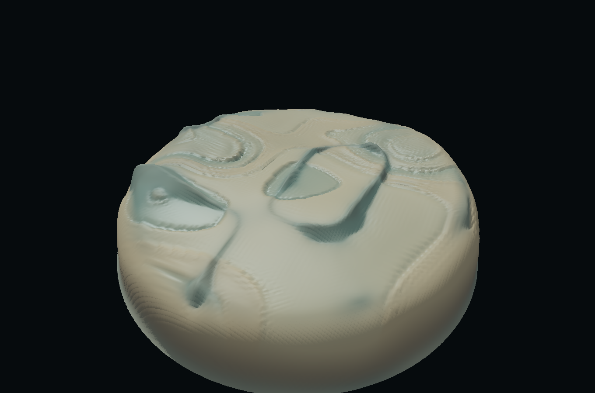

# WORLD — weather becomes matter

**Stage 1 checkpoint: layers 1–3. Not the finished world.**

[Pages address — pending one-time setup](https://anttiluode.github.io/World/) · [Source inspection / reuse decisions](docs/SOURCE_NOTES.md) · [Measured shader results](results/gpu-egl.json)

Sound excites a field of oscillators. The field mobilizes sediment. Sediment travels, settles and compacts; the resulting terrain and compaction change the next force update. This is the loop implemented here.

**Do not hype. Do not lie. Just show.**



The image above is an **EGL render of the actual shader sources**, not a browser screenshot and not generated art. What I see at this checkpoint is a low-relief eroded basin with exposed ridges and sediment accumulation. It does **not yet meet the full CrystalMoon-class visual ambition**. This is the point at which the user asked development to stop and inspect the foundation.

## Deployment status

Source is committed. The first Actions run passed **8/8 Node tests**, then failed at `configure-pages`: **“Create Pages site failed. Resource not accessible by integration.”** Pages is not enabled for this new repository; the workflow token cannot perform that initial administrative action.

Repository owner: open [Settings → Pages](https://github.com/anttiluode/World/settings/pages), select **GitHub Actions** under **Build and deployment → Source**, then [re-run the failed workflow](https://github.com/anttiluode/World/actions/runs/43400898789). The page address above is the intended address, **not a verified live deployment**. No broader token or new credential is requested.

Meanwhile, download `index.html` from this repository and open it locally for generated weather and song input.

## Run it

Open the GitHub Pages link in desktop Chrome, Edge or Firefox with hardware acceleration. Or download `index.html` and open it directly: it has no external assets, libraries, model files, fonts or server dependency. A microphone needs a browser-supported secure context; Pages/HTTPS or localhost is the reliable route. Song input is local to the browser.

- The world starts with deterministic **generated weather**, silently. This is a band-feature fixture, not a generated song.
- **Open a song** decodes audio and prepares a repeatable eight-band feature score. Limits: 120 MB and 20 minutes. Analysis uses the first audio channel, a 2048-sample Hann FFT, at eight observations per second. It is a coarse front end, not a full perceptual audio model.
- **Microphone** samples the live input without playing it back. **Hear the matter** optionally plays four quiet sine voices derived from ground height and oscillator energy. Use headphones with a microphone. The musical mapping is authored sonification, not simulated acoustics.
- Drag to orbit; scroll to approach. **Map view**, **Cinema**, Space to pause and Escape to leave cinema are available.
- Under **Layers & evidence**, select **Raise rock** or **Loosen sediment**, then click the terrain. Raising rock changes the bed; loosening changes compaction without changing the visible surface immediately.
- **Save weather recording** stores feature frames, initial layer modes and interventions as JSON. **Load weather recording** replays them. It does not store the original audio. Replay locks simulation-altering controls; switch back to generated weather, microphone or a song to make a new history.
- **Restart** clears accumulated material history, resets the organ and restarts the input. The seed/initial structure controls also restart. Changing render detail does not change the simulation grid.

## What is routed

The simulation uses a fixed **192 × 192** grid with RGBA32F ping-pong fields and a **32 Hz** simulation clock. The Korva-style organ runs at **8 Hz on the CPU**, not as a GPU pass. The spatial field updates run on the GPU.

| Pass / state | Reads | Writes | Consequence |
|---|---|---|---|
| Seed, once on restart | Integer seed; multiscale noise with phi scale ratio | Bedrock height, hardness, natural-frequency map, domain mask | Initial conditions and local coefficients, not an animated picture |
| Ring organ | Eight band amplitudes thresholded into events; delay history | Three selected echoes and mismatch | The echo and surprise enter the oscillator forcing |
| Forces | Current material height/compaction, neighbor oscillators, band input and organ | Complex oscillator state and bounded 2D transport velocity | Exact rotation with damped nonlinear amplitude; deposition feeds back into damping, frequency and slope |
| Flux | Mobile sediment, force velocity | Four capped outgoing face fluxes | Conservative upwind transport with closed grid boundaries |
| Deposition | Incoming/outgoing flux, resting/mobile sediment, hardness, force stress, compaction | Resting sediment, mobile sediment, compaction, cumulative exchange | Erosion and settlement exchange material without adding it; history changes future response |
| Display | Stored geometry/material/forces, camera, fixed illumination | Screen pixels only | Terrain mesh and field-derived color; this pass never writes simulation state |

This is a **stylized sediment model**, not a validated geological or fluid solver. There is no water-volume or momentum conservation claim. Bedrock is seeded and can be raised by the user; only its sediment cover erodes. One height per horizontal cell means no caves, overhangs or volumetric bodies yet.

## Layer audit

- **Initial structure: flat control** restarts without multiscale bedrock/frequency/hardness variation. Layer 1 is already static after initialization. A freeze toggle there would be fake, so none is offered.
- **Forces: freeze** holds the entire force field. Sediment can still move under that frozen velocity. **Remove field** zeros it each step; mobile material can still settle. It removes external/downhill transport too, not only sound.
- **Deposition: freeze** preserves all material channels bit-for-bit while forces continue. **Remove sediment** clears all four channels; this deliberate ablation destroys sediment mass. Resuming does not magically restore it; restart to restore the initial supply.
- **Rhythm organ: raw input only** removes its echo/surprise contribution. The CPU organ still tracks input for inspection.
- Clicking a frequency-band button silences that band **before** it enters the organ. Previously stored echoes can persist; this is not instantaneous erasure.

## Measured evidence

`node --test tests/core.test.cjs`: **8/8 passed**. Tests include periodic recall, pattern break, silence, deterministic weather, conservative transport, FFT tone separation, recording validation, and repeatable conversion of decoded audio samples to feature scores.

`python tests/gpu_egl.py`: **13/13 passed** on **Mesa llvmpipe (LLVM 19.1.7, 256 bits)**. This executes the HTML's shader bodies through desktop OpenGL/EGL. Only GLSL ES version/precision declarations are translated. It is a real numerical/shader test but **not a WebGL browser test**. Raw data are in [`results/gpu-egl.json`](results/gpu-egl.json).

| Test | Result / measurement |
|---|---|
| Same seed + same feature sequence, 320 steps | Maximum material difference **0** on this backend |
| Same seed + different feature sequence | Mean resting/mobile material difference **0.01732** |
| Conservation, without intervention or layer removal | Relative sediment-mass error **1.16 × 10⁻⁸** after 320 steps |
| Flat versus multiscale seed | Evolved material difference **0.03458**, force difference **0.04013** |
| Forces removed | Material difference **0.03573** versus live control |
| Frozen material / frozen force | Maximum change **0** in each frozen field |
| Forces killed | Field exactly zero |
| Raised rock | After 100 steps, material mean difference **1.28 × 10⁻⁵** and oscillator difference **1.42 × 10⁻⁶**, measured **outside radius 0.12**, beyond the brush's finite radius **0.10** |
| History control | Generate different pasts; explicitly match geometry, mobile material, exposure and force; retain only different compaction. Subsequent common forcing gives material difference **0.000987**. Compaction is not directly colored in the renderer. |
| Organ disabled | Mean material difference **0.00831** versus organ-enabled control |
| Production-size stress run | All fields finite after **1600 steps at 192²**; simulation-only wall time **9.41 s** on llvmpipe, excluding rendering |

Mean differences are absolute field units, not percentages or claims of perceptual significance. The history control is a **constructed matched-state transport-memory experiment**. It does not show that naturally converged look-alike worlds grow different organisms: **growth does not exist yet**.

The on-page **Run measured checks** button runs comparable tests on the actual WebGL backend in your browser at 64² and lets you download the results. It does not overwrite the displayed world. It is an explicit validation tool; its results are not prefilled.

### Verification limits

- The available preview browser could not provide the required WebGL2/float-render-target setup. Its unsupported-device message was observed, but **the interactive WebGL path, song selection/playback, microphone permission flow and narrow-screen interaction have not been verified end to end in a working browser**. Syntax checks, source review, pure-core tests and EGL tests do not erase that gap.
- **RTX 3060 performance has not been measured.** No claim of 60 FPS. Render detail controls pixel budget; the simulation grid stays fixed so quality changes do not change history. The production stress timing above is not render FPS.
- Repeatability means identical input features, interventions, initial modes, grid and execution backend. Floating-point results across GPUs/browsers are not promised bit-identical. Live microphone input itself is not repeatable; captured features are.
- Song simulation catches up without skipping simulation ticks, at a maximum of eight steps per displayed frame. On a sufficiently slow GPU the visuals may lag playback. Hidden tabs pause both. This is a known responsiveness limit, not silently discarded history.
- The original audio and GPU state are not saved in weather recordings. Replays reconstruct from the beginning. Context loss stops audio and requires a restart.

## Honest ledger

| Item | Status |
|---|---|
| Forces → material → forces | Implemented; ablation and intervention measured |
| Persistent history | Resting/mobile material, compaction and cumulative exchange |
| Entrain | Oscillator integration adapted; no growing ears, classifier or Entrain benchmark claim |
| Korva | Ring organ adapted; **no transformer**, trained weights or learned routing |
| Scale | Six seeded noise octaves, phi frequency ratio, authored finite basin mask; not a discovered law |
| What remains authored | Boundary shape; material parameters; eight band boundaries; seed terrain; camera; colors; sonification mapping |
| What remains conventionally rendered | Fixed light direction, ambient term, short height-field shadows, specular term, fog, tone mapping and constant background. Field-derived diagnostic emission is not physical light transport. UI is ordinary HTML. |
| No decorative world overlays | No stars, billboard plants, analytic crystals or free-floating particles are drawn |
| “Every pixel is residue” | **Not literally achieved.** World surface geometry/color read persistent fields, but initial geology and conventional illumination/background are authored. The stronger requirement awaits later stages. |
| Growth / genes / scouts | Not implemented |
| Moon lens / compiled transport | Not implemented; Moon's fitted accuracy does not transfer here |
| Failed / caught in review | Initial song loader shadowed its feature function; fixed by extracting and testing score generation. Replay controls could diverge from their saved history; now locked. Compaction initially affected color and weakened the hidden-state claim; removed from the color readout. Context loss now stops audio. Intervention audit now measures beyond the brush. |
| Full visual ambition | Not achieved at stage 1; do not call this the final world |

## Development

Only `index.html` is needed to run. Tests and results are separate supporting files.

```sh
node --test tests/core.test.cjs
python -m pip install numpy moderngl Pillow
python tests/gpu_egl.py
```

`tests/gpu_egl.py` requires an EGL implementation. It compiles the exact shader bodies and produces a clearly labeled EGL render. It does not launch or automate a browser.

Implementation decisions: [`docs/STAGE1_PLAN.md`](docs/STAGE1_PLAN.md). Source notes explain each requested predecessor, including the distinctions between all three CrystalMoon versions. The MIT license in this repository is retained. Entrain/Korva algorithm adaptations are attributed to those repositories and Antti Luode and their implementation collaborators.

**Next stage is deliberately not started.** First assess whether this bounded material loop is a sufficient foundation; then add growth that changes its coefficients, followed by independently tested material-dependent transport and a lens.
